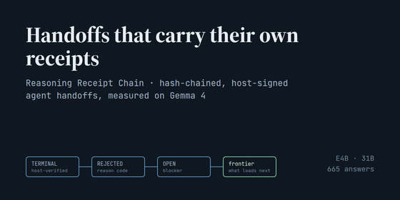

# Handoffs that carry their own receipts

**The Reasoning Receipt Chain, a hash-chained, host-signed handoff format for coding agents, measured on Gemma 4 E4B and 31B**

Paper submitted to the Kaggle *Google – The Gemma 4 Developer Agent Paper Track* (2026).
By John Byars ([Kaggle: johnbyars](https://www.kaggle.com/johnbyars)) for the Possessio AI Council: one human, who ran every job
and owns every decision, and several AI model instances, which wrote the text, code and analyses.

- **Paper:** [Handoffs_that_carry_their_own_receipts.pdf](Handoffs_that_carry_their_own_receipts.pdf)
- **Public kit (kit 2) and reproduction:** [kit2_public.zip](kit2_public.zip)

## In one paragraph

When a coding agent's session ends, its successor gets a summary, and two things go first: which paths were already
tried and rejected, and which claims were actually tested. The Reasoning Receipt Chain (RRC) makes the handoff a record:
every claim carries a status that only the host running the tests may raise to verified, every rejected path carries a
reason, and every open item names its blocker. On Gemma 4, prose readers called unverified claims verified in 60 of 60
E4B answers and 13 of 40 on the 31B; RRC readers in 0 of 100. Given every missing fact, prose readers recalled 48% of
rejected paths against RRC's 100%. Bullets carrying the same fields matched RRC at 32–36% fewer tokens.

## Re-score kit 2 yourself (Python 3, standard library, no GPU)

    unzip kit2_public.zip && cd kit2_public
    python3 verdict_5b.py --selftest
    python3 verdict_5b.py --e4b answers_run5b_e4b --prefix out/r

`out/r_verdict.md` and `out/r_e4b_report.md` come out byte-identical to the included `gpu_run5b_kaggle_*` files.

## What is and is not here

- **Here:** the paper, kit 2 (built from public SWE-agent trajectories), its answer key, the 60 raw Gemma 4 E4B answers,
  the scorer, the generation harness and the pre-registration.
- **Not here:** kit 1 (real security-audit working memory; its targets stay private, so its numbers cannot be re-run from
  outside) and the RRC implementation. The paper says so in Sections 5 and 6.

## License

Apache-2.0 (see LICENSE). Third-party material:

- Kit 2 is derived from nebius/SWE-agent-trajectories (Hugging Face), licensed CC BY 4.0; the trajectories' model
  outputs (swe-agent-llama-70b) are also subject to the Llama 3.1 Community License. Only short identifiers and error
  names are reproduced.
- The answers in kit 2 are outputs of Google's Gemma 4 E4B (google/gemma-4-E4B-it, Apache-2.0).
